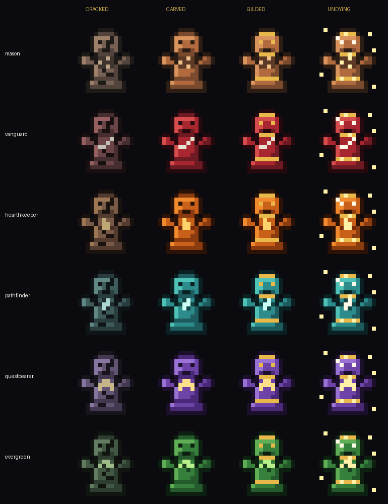

# 04 — Totems

Every player receives exactly **one totem**. It has two parts:

- **Archetype**: *what kind* of year it was. One of 6, decided by **rates** (behaviour per hour) relative to the rest of the server.
- **Tier**: *how much* of a year it was. One of 4, decided by **total playtime** relative to the rest of the server.

That gives 24 combinations. Each is a real 16×16 item texture (`public/rollback/totems/{archetype}_{tier}.png`, preview at `assets/totem-preview-sheet.png`) and will exist as a real in-game item.

## The six archetypes

| id | Name | Archetype | Score (see Scoring) | Palette (outline / dark / mid / light / accent-light) |
|---|---|---|---|---|
| `mason` | The Mason's Totem | Builder | blocks placed per hour | `#2b1d14 #7a4a2e #b06a3e #d9935c #f0c08a` |
| `vanguard` | The Vanguard's Totem | Fighter | mobs and players killed per hour | `#240a0e #6e1a22 #a8262f #d64b4b #e9e2d0` |
| `hearthkeeper` | The Hearthkeeper's Totem | Social | share of playtime with ≥ 1 other player online | `#2a1206 #8a3b10 #c8601a #f08a2c #ffd36b` |
| `pathfinder` | The Pathfinder's Totem | Explorer | distinct chunks per hour, +25% bonus per extra dimension visited | `#0b2022 #1d5b5f #2c8c8c #4fc2b8 #c9fff4` |
| `questbearer` | The Questbearer's Totem | Quester | quests completed (count, not rate: quests are already rare) | `#1b0f2b #4a2a78 #6d43a8 #9a72d6 #ffe08a` |
| `evergreen` | The Evergreen Totem | Devoted | share of season weeks with any session | `#0d1f10 #245a2c #36803c #5fae55 #b8f08a` |

`--rb-totem` (the stage colour from slide 12) = the archetype's **light** colour; the glow uses **accent-light**.

### Copy per archetype

| id | Tooltip (in-game flavour, grey italic) | Archetype line (Academy, slide 12) | Hint line (slide 1, must *not* give it away directly) |
|---|---|---|---|
| mason | *Laid stone where there was none. The world remembers the weight.* | Awarded to those who leave the world more built than they found it. | "The Academy will say only this: the world looks different because of you." |
| vanguard | *Met the night head-on. Still warm from the fight.* | Awarded to those who answered every growl in the dark. | "The Academy noted your… enthusiasm." |
| hearthkeeper | *Never alone for long. Smells faintly of campfire.* | Awarded to those who made the server feel like somewhere. | "The Academy was moved by what it found." |
| pathfinder | *Its eyes point somewhere you haven't been yet.* | Awarded to those who could never quite stay put. | "The Academy had trouble keeping up with you." |
| questbearer | *Heavy with promises kept.* | Awarded to those who said yes to every adventure. | "The Academy rarely sees this kind of dedication." |
| evergreen | *Came back every week. Some things just don't die.* | Awarded to those who were simply always there. | "The Academy appreciated the constant." |

### Tiers

| tier | Name | Rule (percentile of season hours among all season players) | Tooltip tier line | Visual (web) |
|---|---|---|---|---|
| `cracked` | Cracked | < 0.35 | *Weathered by a short year. Still standing.* | Desaturated texture with cracks. No glint. |
| `carved` | Carved | 0.35 – 0.75 | *Carved by a steady hand.* | Base texture. |
| `gilded` | Gilded | 0.75 – 0.95 | *Gilded by a year well spent.* | Gold trim and eyes. Soft gold glow. |
| `undying` | Undying | ≥ 0.95 | *It refuses to break. So did you.* | Gold, glowing eyes, sparkles, plus an animated enchant glint every 3s. In-game: the enchantment glint. |

The tier is never framed as a ranking on screen. The tier name appears as a quiet small-caps label; no percentiles are shown next to it.

## Scoring (backend, `rollback.mv_player_scores`)

1. **Population:** every player with at least one session in the season.
2. **Raw rates**, using **shrinkage** so tiny samples can't spike (5 blocks in a 1-minute session must not make someone the top builder):
   `rate = count / (hours + 3)`, i.e. three phantom hours of nothing are added to everyone.
   - mason: `blocks_placed / (hours + 3)`
   - vanguard: `kills / (hours + 3)` (kills = `type='kill'`, any reference)
   - hearthkeeper: `overlap_hours / (hours + 3)` (overlap with any other player, with simultaneous overlaps counted once, so it's ≤ hours)
   - pathfinder: `chunks / (hours + 3) × (1 + 0.25 × (dimensions_visited − 1))`
   - questbearer: `quests_completed` (raw count)
   - evergreen: `active_weeks / season_weeks` (52)
3. **Percentile rank** of each score across the population, computed **only over players with hours ≥ 2** (so the scale is set by real players). Players under 2h are placed into that distribution with the same thresholds (compute their percentile by counting how many ≥2h players they beat). Postgres: `percent_rank()` over the eligible set, plus a lateral count for the rest.
4. **Archetype** = the dimension with the highest percentile. Ties are broken in this fixed order: `questbearer > vanguard > mason > pathfinder > hearthkeeper > evergreen` (rarer behaviours win ties).
5. **No signal at all** (every percentile is 0, e.g. a player who logged in once and did nothing): `pathfinder` ("you came, you looked around"). The hint line still works.
6. **Tier** = `percent_rank()` of total season hours across **all** season players, using the thresholds above.
7. **Distribution check:** before locking, review `GET /rollback/{year}/stats` (see `05-backend.md`). If one archetype takes over 35% of players, tune the weights (pathfinder bonus, shrinkage constant) and rebuild. Document the final constants in the migration's comments.

The **chapter behaviour** (slide 2) reuses these percentiles: the highest one picks the behaviour (mason → building, vanguard → combat, questbearer → questing, hearthkeeper → social, evergreen/pathfinder → playtime).

## Locking

`POST /rollback/{year}/build` refreshes the views and upserts `rollback.totem_award` for every player, **unless** the season is locked. `POST /rollback/{year}/lock` sets `locked_at`; from then on the award table is the source of truth, and rebuilds never touch existing rows (new late rows, if any, are inserted only). Lock before `published_at`.

## The reveal

See `03-slides.md` § Slide 12. The totem "pop" mimics the in-game Totem of Undying activation: shudder, a burst toward the camera, a flash and particles in the totem colours, then a settle. It's the emotional peak of the show.

## In-game items (Bedrock)

Out of scope for the two repos in this plan except for the **claim API** (see `05-backend.md`), but specified here so the addon work can happen in parallel:

- **24 custom items**, ids `everthorn:rollback26_{archetype}_{tier}` (e.g. `everthorn:rollback26_mason_gilded`), in the Everthorn behaviour pack and resource pack.
- **Textures:** copy `public/rollback/totems/*.png` to `RP/textures/items/rollback26/` and register them in `RP/textures/item_texture.json` as `rollback26_{archetype}_{tier}`.
- **Item component sketch (BP):** `minecraft:icon` → the texture key; `minecraft:display_name` → the totem name; `minecraft:max_stack_size: 1`; `minecraft:glint: true` **only** for the `undying` tier; `minecraft:hand_equipped: false`. These are trophies, so they don't act as Totems of Undying.
- **Lore:** tier line, flavour tooltip and `Everthorn Rollback '26` set as item lore via the scripting API when the item is given (`ItemStack.setLore`).
- **Delivery flow:** when a player joins, the addon or bot calls `GET /guilds/me/rollback/2026/awards/{thorny_id}`. If `claim.status == 'pending'`, it gives the item and calls `POST …/awards/{thorny_id}/claim`. The claim is idempotent.
- **Regenerating textures:** `python3 docs/rollback-26/assets/generate_totems.py public/rollback/totems` (Pillow). Edit the `SHAPE`, `EMBLEMS` and `PAL` tables in the script, not the PNGs.
